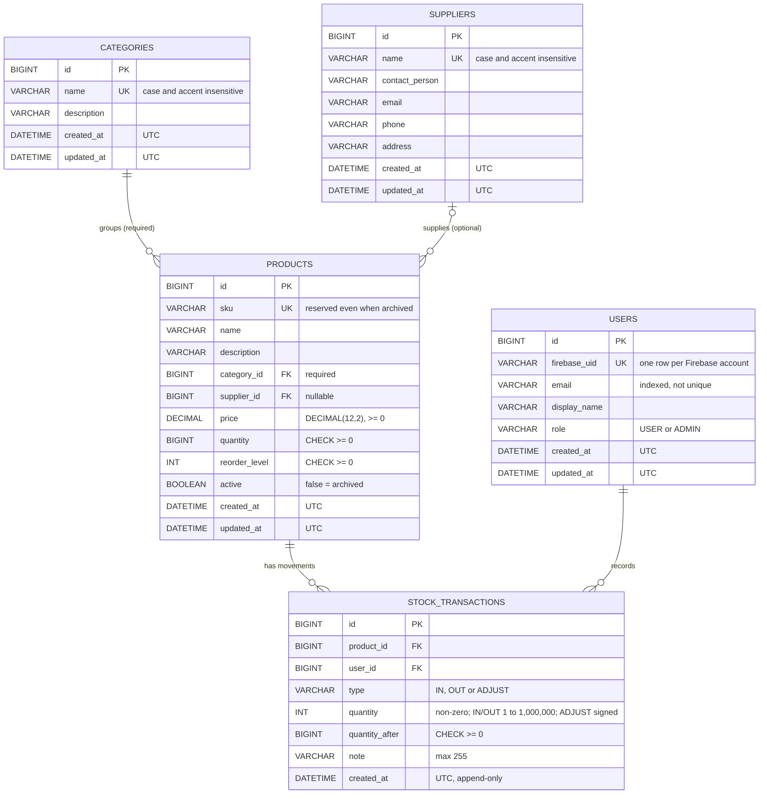

# Entity-Relationship Diagram

Source of truth: [`database/schema.sql`](../database/schema.sql). This diagram is a summary; if the two ever disagree, the schema wins.

## Notes

- **Foreign keys:** every foreign key uses `ON DELETE RESTRICT`. Nothing is deleted in cascade, so stock history is never lost.
- **Archive, not delete:** "deleting" a product sets `active = FALSE`. Archived products keep their SKU and their movement history.
- **Quantity:** `products.quantity` changes only through stock movements. `stock_transactions` is append-only, and `quantity_after` records the stock level right after each movement.
- **Low stock:** calculated in queries as `quantity <= reorder_level`, not stored.
- **Timestamps:** all `DATETIME(6)` values hold UTC.
- **ADJUST:** the table above shows the schema after migration `002` (`database/migrations/002_stock_adjustments.sql`). Existing databases must run that migration first; see `database/README.md` section 8b.
